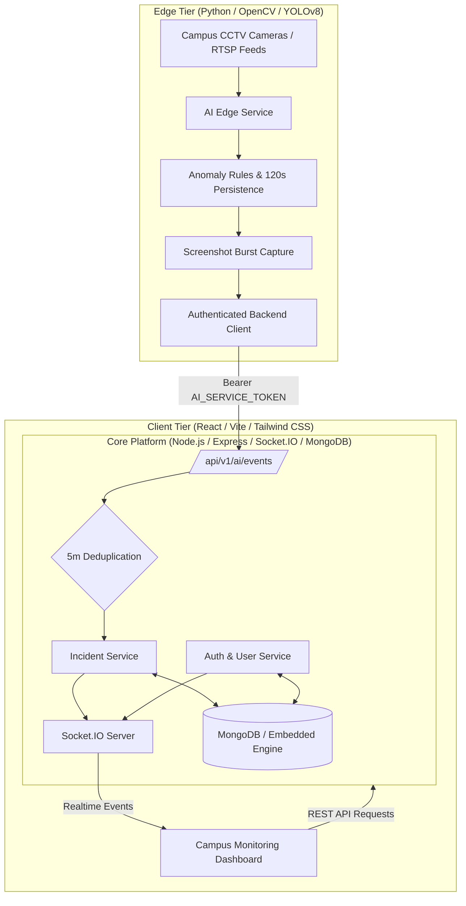

# Smart Campus Monitoring Application

An intelligent, multi-tier campus operations and safety monitoring platform. The application ingests video telemetry and detection candidates from edge AI computers running YOLO, transforms raw camera feeds into actionable operational insights (occupancy density, parking space availability, and security incidents), and delivers role-tailored real-time dashboards across university administrative and student tiers.

---

## 1. System Architecture



---

## 2. Technology Stack

- **Frontend**: React 19, Vite, Tailwind CSS v4, Lucide React icons, React Router DOM, Socket.IO Client.
- **Mobile**: React Native 0.88, Expo SDK 58, Expo Router (file-based navigation), Lucide React Native, React Native Safe Area Context.
- **Backend**: Node.js, Express, MongoDB with Mongoose, Socket.IO, JWT, bcryptjs, Helmet, Express Rate Limit.
- **AI Edge Service**: Python 3.10+, Ultralytics YOLOv8, OpenCV, Requests, Python-dotenv.
- **Shared Contracts**: Canonical roles, incident state machine transitions, event definitions, and threshold constants in `shared/constants.json` and `shared/api-contracts.md`.

---

## 3. Repository Structure

```
Smart-Campus-Monitoring/
├── .gitignore                     # Monorepo ignore rules (caches, .env, build output)
├── README.md                      # Unified project overview and quick start guide
├── shared/                        # Shared contracts across tiers
│   ├── constants.json             # Canonical roles, statuses, and socket events
│   └── api-contracts.md           # REST endpoint specifications and payload schemas
├── backend/                       # Node.js REST API and Socket.IO server
│   ├── .env.example               # Backend environment template
│   ├── server.js                  # Entry point
│   ├── src/                       # App, server lifecycle, config, and realtime
│   ├── modules/                   # Domain modules (auth, users, cameras, incidents, etc.)
│   └── tests/                     # 92 unit, integration, and E2E tests
├── frontend/                      # React 19 + Vite single page web application
│   ├── .env.example               # Frontend environment template
│   ├── src/                       # Components, contexts, hooks, pages, routes, services
│   └── tests/                     # 34 unit and contract tests
├── mobile/                        # React Native + Expo mobile application (Step 3 Complete)
│   ├── .env.example               # Mobile environment template (EXPO_PUBLIC_API_URL)
│   ├── app.json                   # Expo configuration, plugins (expo-router, expo-secure-store)
│   ├── app/                       # Expo Router file-based layouts and route groups
│   │   ├── _layout.jsx            # AuthProvider, NavigationGuard, SafeAreaProvider, StatusBar
│   │   ├── index.jsx              # Foundation & system status screen with auth entry gateway
│   │   ├── +not-found.jsx         # Fallback error screen
│   │   ├── (auth)/login.jsx       # Native login screen (email, password, show/hide, alerts)
│   │   └── (app)/                 # Protected role-aware route group
│   │       ├── _layout.jsx        # Protected stack with session guard & route registration
│   │       ├── index.jsx          # Role-tailored operational dashboard & metrics
│   │       ├── parking.jsx        # Campus parking availability, capacity, & progress bars
│   │       ├── occupancy.jsx      # Crowd density, 70%/90% threshold badges, & zone telemetry
│   │       ├── incidents/         # Staff-only safety incident workflow
│   │       │   ├── index.jsx      # Incident list with status filter chips
│   │       │   └── [id].jsx       # Incident detail with authorized state machine actions
│   │       ├── cameras.jsx        # Staff-only CCTV camera node connection telemetry
│   │       └── unauthorized.jsx   # Access denied fallback screen
│   ├── components/                # Reusable UI (HeaderBar, MetricCard, StatusBadge, EmptyState, ErrorState)
│   ├── contexts/                  # AuthContext (session lifecycle & race-condition safe restore)
│   ├── hooks/                     # useAuth hook
│   ├── services/                  # apiClient, authService, campusService, tokenStorage
│   ├── constants/                 # Theme, platform-aware config, campus roles, and RBAC permissions
│   ├── utils/                     # calculations (percentages, crowd status, incident state machine)
│   └── tests/                     # 29 automated mobile unit & contract tests
└── ai-service/                    # Python edge video analysis and detection service
    ├── .env.example               # AI service environment template
    ├── requirements.txt           # Python dependencies
    ├── main_edge.py               # Edge service entry point and loop
    ├── detector/                  # YOLO crowd, vehicle, and person detectors
    ├── rules/                     # Alert candidate evaluation and thresholds
    └── tests/                     # 35 unit and integration tests
```

---

## 4. Quick Start Guide

### Step 1: Backend Setup & Launch
```bash
cd backend
npm install
cp .env.example .env
npm run dev
```
*Note: In development, if a local MongoDB server is not listening on port 27017, the backend automatically boots an embedded in-memory MongoDB engine and seeds demo campus data.*

### Step 2: Frontend Setup & Launch
```bash
cd frontend
npm install
cp .env.example .env
npm run dev
```
Open **[http://localhost:5173](http://localhost:5173)** in your browser.

### Step 3: Edge AI Service (Optional / Demonstration)
```bash
cd ai-service
python -m venv .venv
# On Windows: .venv\Scripts\activate | On Linux/macOS: source .venv/bin/activate
pip install -r requirements.txt
cp .env.example .env
python main_edge.py
```

### Step 4: Mobile Application (Expo / React Native)
```bash
cd mobile
npm install
cp .env.example .env
npm start
```

**Development Runtime API Configuration (`mobile/.env`):**
- **Android Emulator**: Set `EXPO_PUBLIC_API_URL=http://10.0.2.2:5000/api/v1` (Android maps host `localhost` to `10.0.2.2`).
- **iOS Simulator / Web**: Set `EXPO_PUBLIC_API_URL=http://localhost:5000/api/v1`.
- **Physical Device (Expo Go)**: Set `EXPO_PUBLIC_API_URL=http://<YOUR_LAN_IP>:5000/api/v1` (e.g., `http://192.168.1.100:5000/api/v1`).
*(If omitted, `mobile/constants/config.js` automatically uses platform-aware defaults and detects Expo Go LAN host addresses).*

**Target Launch Commands:**
- `npm run android` — Launch on connected Android device/emulator.
- `npm run ios` — Launch on iOS simulator (macOS only).
- `npm run web` — Run in Metro web mode.

---

## 5. Seed Demonstration Accounts

| Role | Email | Password | Access Scope |
|---|---|---|---|
| **Super Admin** | `admin@campus.edu` | `Admin@123456` | Global operations, cameras, parking, crowd, incidents, users, settings |
| **Dept Head** | `depthead@campus.edu` | `DeptHead@123456` | Department-focused dashboard, cameras, incidents, user management |
| **Faculty** | `faculty@campus.edu` | `Faculty@123456` | Cameras, incidents, parking, crowd (no user provisioning) |
| **Student** | `student@campus.edu` | `Student@123456` | Public parking, occupancy, campus resources (private surveillance stripped) |

---

## 6. Running Verification Test Suites

Execute all automated test suites across the monorepo:

```bash
# 1. Backend Test Suite (92 tests)
cd backend && npm test

# 2. Frontend Test Suite (34 tests) & Lint
cd ../frontend && npm test && npm run lint && npm run build

# 3. Python AI Edge Service Test Suite (35 tests)
cd ../ai-service && python -m unittest discover -s tests -v

# 4. Mobile Test Suite (29 tests)
cd ../mobile && npm test
```

**Total Test Coverage: 190 automated tests across all tiers, 0 failures, 0 lint warnings.**

---

## 7. Security Highlights

- **Server-Side Authorization**: Permissions are verified on every request using HS256 JWTs with strong secrets (&ge; 32 characters).
- **Incident Privacy**: All raw evidence files and camera URLs are stripped for students.
- **Privilege Escalation Prevention**: Department heads cannot assign administrator roles or modify accounts outside their department.
- **IDOR Protection**: All identifiers validated against MongoDB ObjectIds; malformed requests return `400 Bad Request`.
- **Sliding-Window Deduplication**: Edge AI candidate events on the same camera and event type are deduplicated within a 5-minute window to prevent alert fatigue.
